# Flow-Zap

**Cobrança de vendas parceladas pelo WhatsApp, no automático, para uma loja de celulares.**


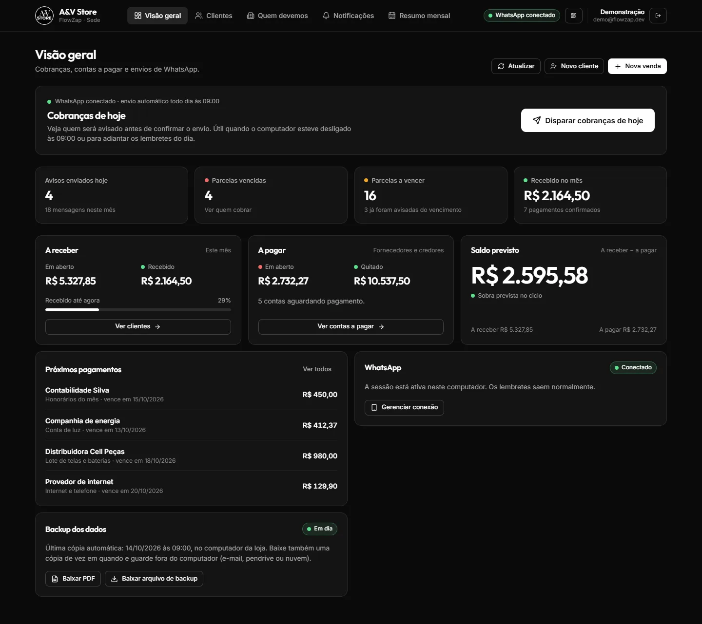

> Todas as imagens deste README usam uma loja de demonstração, com clientes, valores e telefones fictícios. Ela vem no repositório: veja [Rodar a demonstração](#rodar-a-demonstração).

---

## O problema

A A&V Store vende celulares e acessórios parcelados direto com o cliente, sem cartão, no "carnê". Antes do Flow-Zap, cobrar era trabalho manual: abrir uma planilha, ver quem vencia na semana, mandar mensagem por mensagem no WhatsApp e lembrar quem já tinha sido avisado. Parcelas atrasavam porque ninguém lembrava de cobrar, e o dono não tinha uma visão clara de quanto entrava e quanto saía no mês.

## A solução

Um sistema web que:

- **cobra sozinho pelo WhatsApp**: três lembretes antes do vencimento (3, 2 e 1 dia) e um aviso no dia, um por dia e nunca repetido, com proteções para o número da loja não ser bloqueado;
- **organiza a carteira de clientes**: quem deve, quanto, há quantos dias, e um botão "Marcar pago" que já avança a venda para a próxima parcela;
- **mostra o dinheiro do mês**: recebido, a receber, contas a pagar da loja e saldo, mês a mês;
- **protege os dados**: backup diário automático, exportação em PDF e JSON, e restauração por linha de comando.

O dono usa no computador da loja e no celular. Ninguém precisa abrir o WhatsApp para cobrar.

---

## Telas

### Clientes: quem cobrar primeiro

Uma linha por cliente, ordenada por urgência (mais dias de atraso no topo). Tocar no cliente abre as vendas dele ali mesmo, com "Marcar pago", histórico de mensagens, edição e observações internas.

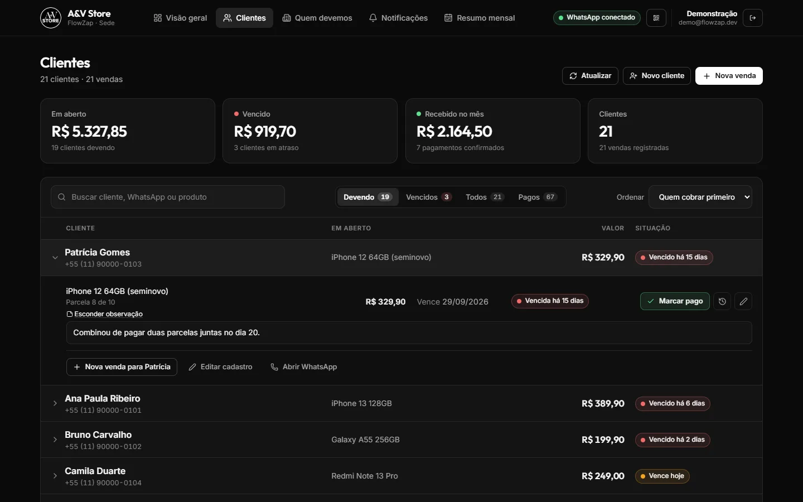

### Nova venda

O campo de cliente aceita busca por nome ou telefone. Um nome que não está na lista vira "Cliente novo", e a venda pode ser feita até para quem não tem cadastro.

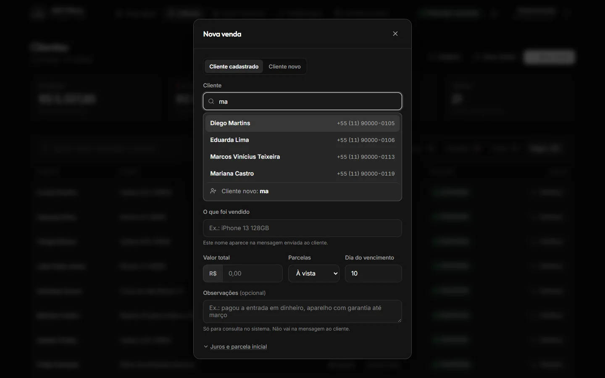

### Notificações: o que o robô enviou e para quem

Avisos de hoje, histórico de envios (com o pagamento de cada um), clientes em atraso e o interruptor do envio automático.

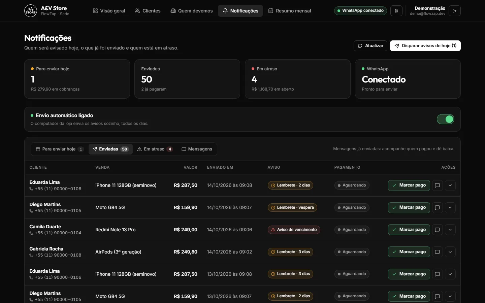

### Mensagens editáveis

O texto de cada aviso pode ser personalizado com variáveis (`{nome}`, `{valor}`, `{vencimento}`, `{pix}`...), com prévia de como o cliente recebe. A saudação é obrigatória e varia a cada envio (veja [anti-bloqueio](#2-fila-anti-bloqueio-do-whatsapp)).


### Resumo mensal

Escolhe-se o mês e se vê o que entrou, o que saiu, o que ficou em aberto e a evolução dos últimos seis meses.

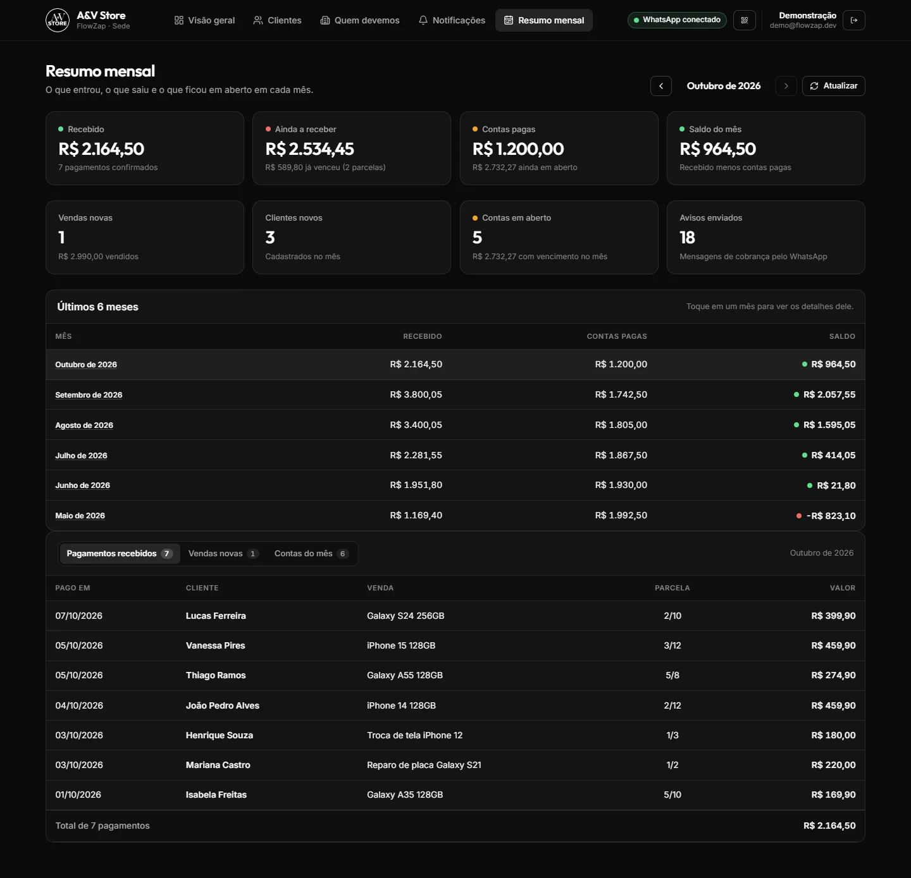

<details>
<summary><b>Mais telas: pagamentos recebidos e contas a pagar</b></summary>

<br>

Pagamentos recebidos, com "Desfazer" para corrigir um clique errado:

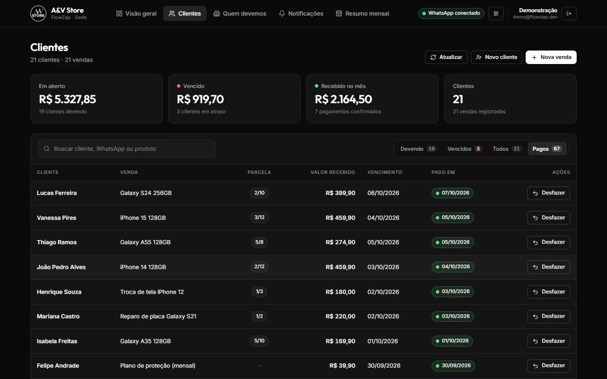

Contas a pagar da loja (fornecedores, aluguel, energia):

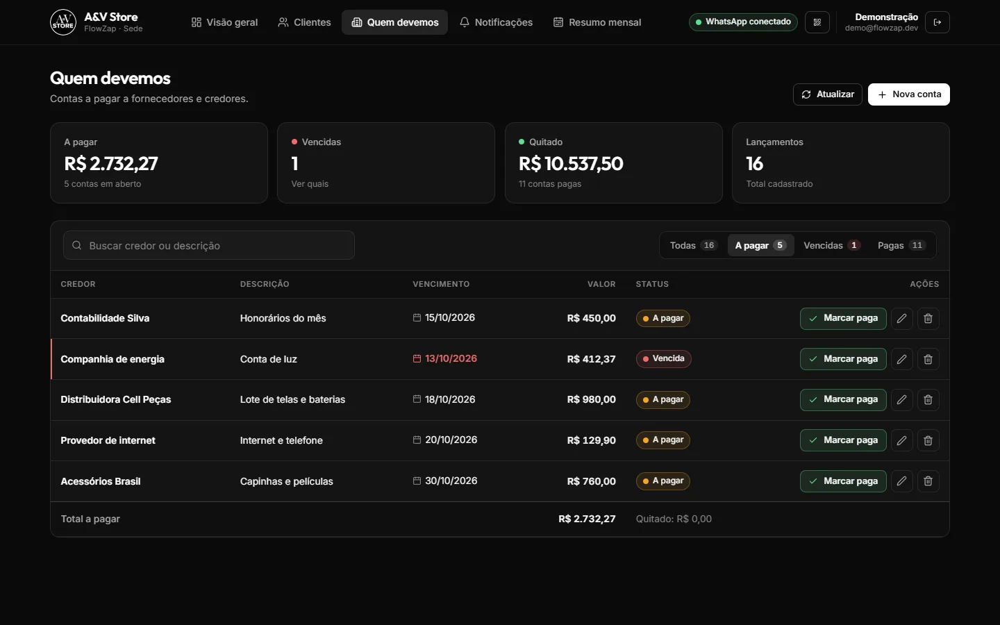

</details>

### No celular

No celular as tabelas viram cartões, a navegação vai para a base da tela e todo botão tem pelo menos 44 px de altura.

<table>
  <tr>
    <td>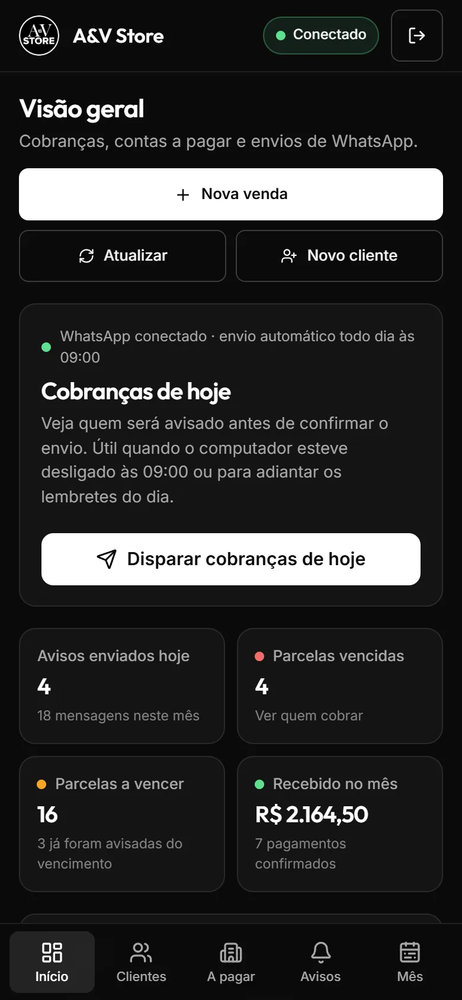</td>
    <td></td>
    <td>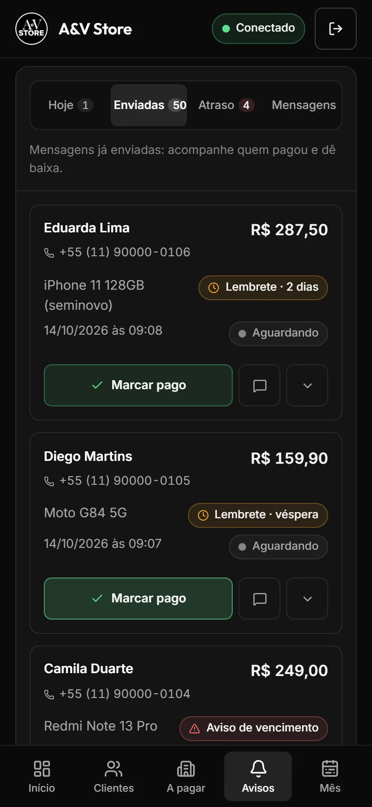</td>
    <td>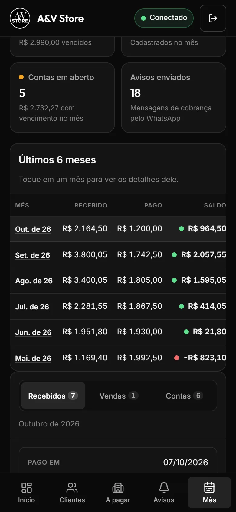</td>
  </tr>
</table>

---

## Arquitetura

O WhatsApp exige uma conexão aberta o tempo todo (o Baileys mantém um WebSocket com os servidores do WhatsApp e guarda a sessão em disco). Isso não cabe numa função serverless, e a loja não queria pagar servidor. A saída foi uma arquitetura híbrida, com o mesmo código rodando em dois lugares:

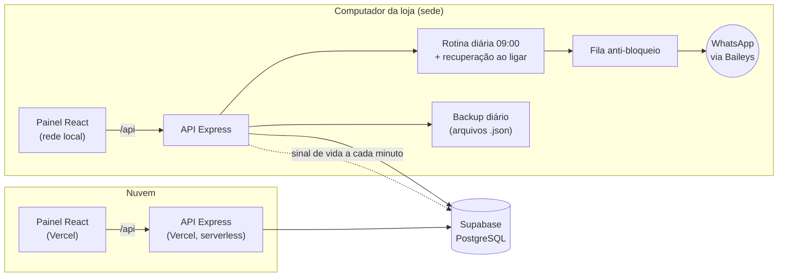

- **Na Vercel** ficam o painel e a API para acesso de qualquer lugar: consultar, cadastrar, marcar pagamentos. Lá o WhatsApp aparece sempre como indisponível, e o painel mostra se a sede está online, lendo o sinal de vida que ela grava no banco.
- **No computador da loja (a "sede")** roda a mesma API, agora com o WhatsApp conectado, a rotina diária, a fila de envio e o backup. Ela inicia sozinha com o Windows e se atualiza sozinha a partir do ramo `producao`.
- **O banco** é um único Supabase (plano gratuito), compartilhado pelos dois.

O backend segue Clean Architecture: controllers só tratam HTTP e validação (Zod); services têm a regra de negócio; repositories ficam atrás de interfaces. Os serviços dependem de `IWhatsAppGateway`, não do Baileys: a sede injeta o gateway real e a Vercel injeta um que responde "indisponível". É essa inversão que permite montar a mesma API nos dois lugares, testar tudo sem banco e sem WhatsApp e ainda oferecer um terceiro modo, a [demonstração](#rodar-a-demonstração): a API de verdade sobre repositórios em memória e um WhatsApp de mentira.

---

## Decisões técnicas e desafios

### 1. Lembretes que nunca se repetem, mesmo com o computador desligado

A rotina roda às 09:00. Se o computador estava desligado nesse horário, ela roda quando ele liga ("recuperação"). Em vez de guardar "a rotina do dia já rodou", **cada envio é registrado em `historico_mensagens`**, e antes de enviar o sistema pergunta: *esta venda já recebeu este tipo de aviso neste ciclo?*

```
Vence dia 20 → dia 17: lembrete_3d · dia 18: lembrete_2d · dia 19: lembrete_1d · dia 20+: vencido (uma vez)
```

Com isso, rodar a rotina duas vezes, religar o computador ou disparar à mão nunca duplica mensagem. O "ciclo" é uma janela de 20 dias antes do vencimento. Uma versão anterior usava 30 dias e, em fevereiro, confundia o aviso do mês anterior com o atual; o caso virou teste.

### 2. Fila anti-bloqueio do WhatsApp

Disparar dezenas de mensagens iguais em sequência é o jeito mais rápido de ter o número da loja banido. A fila de envio:

- é **FIFO e sequencial**: uma mensagem só sai depois que a anterior terminou;
- espera um **intervalo aleatório de 8 a 20 segundos** entre envios;
- mostra **"digitando..." por 3 segundos** antes de cada mensagem;
- **varia a saudação** ("Olá", "Oi", "Tudo bem?", "Como vai?"), para que as mensagens não tenham texto idêntico. Por isso `{saudacao}` é obrigatória em mensagens personalizadas, e o Zod recusa um texto sem ela;
- **confere se o número tem WhatsApp** antes de enviar, e registra o erro no histórico em vez de tentar de novo;
- **espera a reconexão** quando o WhatsApp cai, em vez de marcar as mensagens como falha.

### 3. Uma única sede, garantida pelo banco

Se dois computadores fossem iniciados com o mesmo banco, cada um enviaria as cobranças pelo seu WhatsApp, e o cliente receberia tudo em dobro. A trava é uma **gravação condicional e atômica** em `sede_status`: só grava o próprio identificador quem encontra a trava livre ou já é o dono. O segundo computador sobe apenas como painel: não envia, não conecta o WhatsApp e mostra qual máquina é a sede.

Trocar de sede é sempre uma decisão de uma pessoa (o botão "Usar este computador como sede"). O sistema **nunca toma a trava sozinho** porque a outra máquina ficou sem sinal: um computador que só estava sem internet voltaria enviando junto. A antiga sede percebe a troca em até um minuto e para.

### 4. Datas: fim de mês e fuso horário

- **"Marcar pago" soma exatamente um mês**, respeitando meses de 28, 29, 30 e 31 dias: uma venda que vence todo dia 31 segue 31/10, 30/11, 31/12, 31/01, 28/02 (29 em ano bissexto), 31/03. O dia original fica guardado para não "escorregar" para o dia 28 depois de fevereiro.
- **Os meses são contados no horário do Brasil (UTC-3)**, inclusive na Vercel, onde o servidor está em UTC. Um pagamento às 23h do dia 31 pertence ao mês que termina, não ao seguinte.

### 5. Desfazer pagamento sem perder informação

"Marcar pago" avança a venda para a próxima parcela e o próximo vencimento. Para que um clique errado tenha volta, cada pagamento guarda um **retrato da venda antes da mudança** (parcela, vencimento, status e valor) em `detalhes`. "Desfazer" restaura esse retrato e apaga o registro. Só o pagamento mais recente de cada venda pode ser desfeito, para a história não ficar inconsistente.

### 6. Plano gratuito do Supabase sem perder dados

O plano gratuito não tem backup e pausa o projeto depois de alguns dias sem uso. Então:

- a sede grava um **backup diário** em JSON (pode apontar para uma pasta do OneDrive) e mantém os 30 mais recentes;
- **um banco vazio nunca sobrescreve backups**: se a consulta voltar vazia e já existirem cópias, o backup do dia não é gravado e as antigas não são apagadas;
- a **restauração** (`npm run backup:restaurar`) só mostra o conteúdo; para gravar, é preciso `--confirmar`;
- o painel gera um **relatório em PDF** no próprio navegador (`jspdf`, carregado só quando usado);
- o sinal de vida da sede, a cada minuto, mantém o projeto do Supabase ativo enquanto a loja está aberta;
- a tabela de usuários (senhas) fica fora do backup.

### 7. Deploy na Vercel com um backend de arquivo único

A Vercel executava o código compilado sem as dependências (`Cannot find module 'express'`). O backend passou a ser empacotado pelo **esbuild em um único `app.js`**, com todas as dependências embutidas. O ponto de entrada da Vercel (`app.ts`) nunca importa o Baileys: ele só é carregado por `index.ts`, que roda na sede.

### 8. Banco que evolui sem quebrar o que está rodando

Cada mudança no banco é um arquivo de migração que o dono do projeto roda no Supabase. Entre o deploy e a migração, o código precisa continuar funcionando. Por isso as consultas trazem a venda com `vendas(*)` em vez de listar colunas, e campos novos (como observações) só são enviados quando têm valor. Uma coluna que ainda não existe nunca derruba a tela.

### 9. Atualização automática do computador da loja

A sede é um clone do repositório no ramo `producao`. Ao iniciar, o script baixa a versão nova e reinstala dependências só se `package-lock.json` mudou. Ele **sempre inicia o sistema**: sem internet, com conflito ou com repositório inacessível, sobe a versão atual com um aviso, e nunca fica parado pedindo senha. Como o `cmd` do Windows lê o `.bat` aos pedaços enquanto executa, o script roda a partir de uma cópia temporária, para que a atualização possa reescrevê-lo com segurança.

### 10. Interface feita para quem não é técnico

- **Preto e branco, cor só para status**: verde é pago, âmbar é atenção, vermelho é atraso. A cor nunca aparece sozinha; vem sempre com rótulo ou ícone, e os tons foram conferidos para daltonismo e contraste AA.
- **Um botão principal por tela.**
- **Erro nunca parece lista vazia**: se o carregamento falha, a tela diz isso, oferece "Tentar de novo" e mantém os dados anteriores.
- **Confirmações mostram quem, o quê e quanto** antes de marcar um pagamento.
- **Acessibilidade**: as janelas prendem o foco, fecham com Esc e devolvem o foco ao sair; a navegação funciona pelo teclado.

---

## Qualidade

- **347 testes automatizados** (Vitest) em 47 arquivos, escritos antes do código (TDD), cobrindo regras de cobrança, datas, fila, trava de sede, backup, resumo mensal, rotas e repositórios.
- Repositórios atrás de interfaces: os testes rodam **sem banco e sem WhatsApp**.
- TypeScript em modo `strict` no backend e no frontend.
- Toda entrada da API passa por esquemas **Zod**; rotas autenticadas por **JWT**; senhas com **bcrypt**.
- Commits no padrão Conventional Commits.

```bash
cd backend
npm test            # 347 testes
npm run typecheck   # checagem de tipos
```

---

## Stack

| Camada | Tecnologias |
|---|---|
| Frontend | React 19, TypeScript, Vite, Axios, Lucide, jsPDF |
| Backend | Node.js, Express, TypeScript, Zod, JWT, bcryptjs, node-cron |
| WhatsApp | Baileys (conexão direta, sem API paga e sem Docker) |
| Banco | Supabase (PostgreSQL), com RLS ativado |
| Testes | Vitest |
| Build e deploy | esbuild, Vercel (múltiplos serviços), scripts `.bat` com Agendador de Tarefas do Windows |

---

## Estrutura do repositório

```
backend/
  src/
    controllers/    HTTP + validação Zod
    services/       regras de negócio (cobrança, fila, avisos, trava de sede, backup, resumo)
    repositories/   acesso ao Supabase, atrás de interfaces
    schemas/        contratos Zod
    routes/         rotas Express
    create-app.ts   montagem da API (recebe gateway do WhatsApp e repositórios)
    app.ts          entrada da Vercel (sem Baileys)
    index.ts        entrada da sede (WhatsApp, rotina diária, backup)
    demo/           demonstração: repositórios em memória, loja fictícia e WhatsApp de mentira
  build.mjs         empacota o backend em app.js (esbuild)
frontend/
  src/
    views/          telas
    components/     janelas e componentes compartilhados (components/ui)
    utils/          formatação, agrupamento de clientes, exportação de backup
database/           setup_completo.sql e migrações
scripts/            inicialização e atualização da sede no Windows
docs/screenshots/   imagens deste README
```

---

## Rodar a demonstração

Uma loja fictícia completa, sem Supabase, sem `.env` e sem WhatsApp: a API é a mesma de produção, mas os dados ficam na memória e o "WhatsApp" só escreve no log o que enviaria. Dá para cadastrar, marcar pagamentos e até disparar os avisos do dia para ver a fila funcionando.

```bash
cd backend && npm install && npm run demo     # API de demonstração em :3191
cd frontend && npm install && npm run demo    # painel em http://localhost:5191
```

No Windows, `scriptsiniciar_demo.bat` faz tudo isso e abre o navegador. O login (`demo@flowzap.dev` / `demo1234`) já vem preenchido. As datas da loja acompanham o dia de hoje, e tudo volta ao estado inicial quando a API de demonstração é reiniciada. As portas são próprias, então a demonstração roda ao lado do sistema de verdade.

---

## Como rodar com banco de verdade

**Pré-requisitos:** Node.js LTS e um projeto no Supabase.

1. No SQL Editor do Supabase, rode [`database/setup_completo.sql`](database/setup_completo.sql).
2. Crie o `.env` na raiz a partir de [`.env.example`](.env.example), com `SUPABASE_URL`, `SUPABASE_SERVICE_ROLE_KEY` e `JWT_SECRET`.
3. Crie os logins iniciais com `npm run seed:users` (dentro de `backend`).
4. Suba os dois serviços:

   ```bash
   cd backend && npm install && npm run dev     # API em :3001 (com WhatsApp)
   cd frontend && npm install && npm run dev    # painel em :5173
   ```

5. Abra `http://localhost:5173`, entre e leia o QR Code do WhatsApp pelo indicador no topo da tela.

Para instalar no computador da loja (inicialização com o Windows, atalho, backup na nuvem e atualização automática), siga [`INSTALACAO.md`](INSTALACAO.md).

---

Desenvolvido por [@SchaideNunes](https://github.com/SchaideNunes) para a A&V Store.
